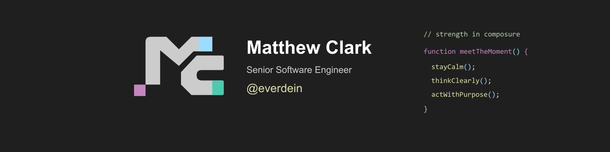
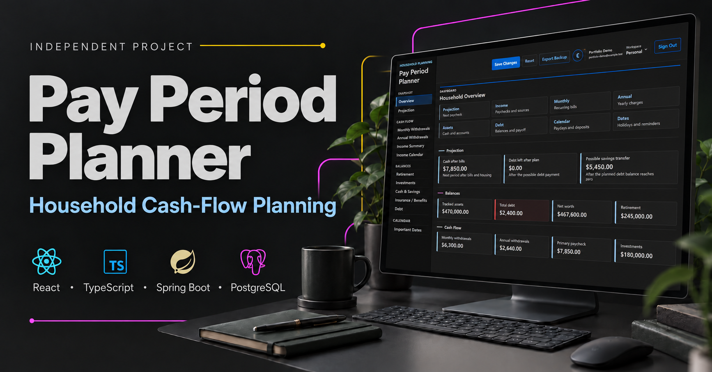
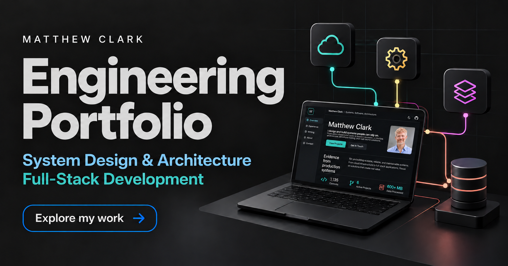
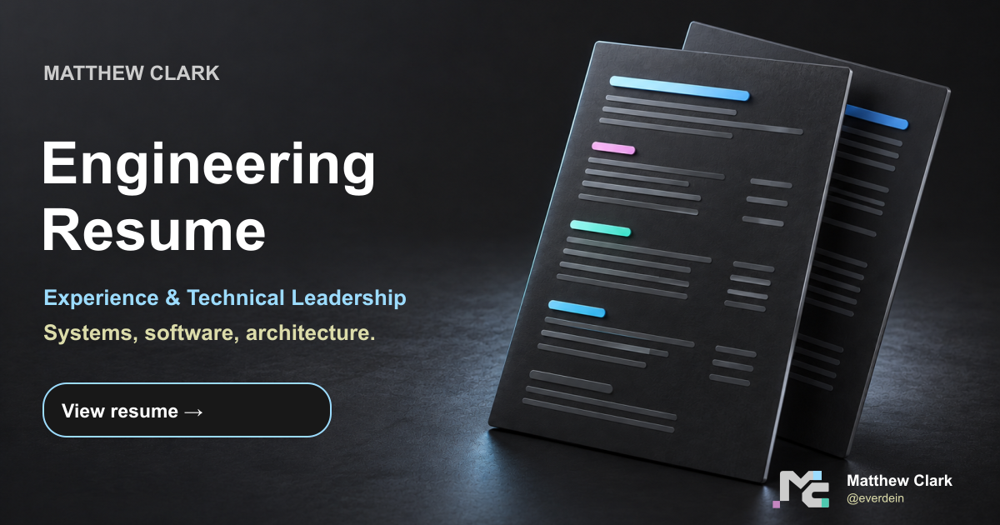
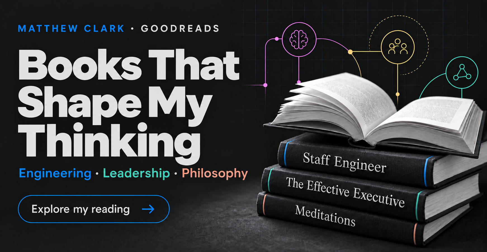

# Matthew Clark

**Senior Software Engineer | Application Architecture & System Design | Technical Leadership**

[Portfolio](https://everdein.github.io/portfolio/)
| [LinkedIn](https://linkedin.com/in/everdein)
| [Resume](https://everdein.github.io/portfolio/resume/)

I design and build reliable, maintainable systems, combining hands-on
development with system design, application architecture, and technical
leadership. My work spans frontend applications, backend services, APIs,
storage, data platforms, and the enterprise integrations connecting them.

## Current Work at PBK

As a **Senior Software Engineer at PBK**, I partner with business stakeholders,
IT, and external development teams to clarify requirements, define system
boundaries and data flows, and guide implementation and modernization.

- Design across applications, services, storage, and upstream and downstream
  dependencies; review applications and guide technical handoffs.
- Develop and evaluate solutions using Microsoft Azure, Databricks, Microsoft
  Fabric, Next.js, and Abacus.AI, with enterprise integration work involving
  Concur, Workday, Deltek, Salesforce, and Autodesk.
- Build an AI-assisted PDF review workflow intended to cover **1,200+ Deltek
  projects**, identifying missing project data and developing green, yellow,
  and red completeness ratings to prioritize follow-up. This work is ongoing.

I also use AI-assisted programming for implementation, refactoring, testing,
documentation, and technical exploration while retaining human review and
architectural ownership. That development practice is distinct from applying
generative AI within a business workflow.

## Professional Impact

Selected outcomes from my State Farm tenure include:

- Architected and built two customer-facing applications from the ground up.
- Led transaction workflows that supported 1,404 submissions across 1,174
  policies during a measured 30-day production period.
- Grew the primary application from zero test files to 3,335 test cases—3,327
  passing, zero failing, and 97.08% coverage—then embedded quality into six
  independently diagnosable CI gates with Playwright and Axe validation.
- Established roughly 40 shared modules supporting more than 90 source and test
  files across two applications.
- Excluded more than 600 MB of build-time dependencies from production images
  across both applications and remediated 10 vulnerable items spanning five
  CVEs.
- Established a 45-page engineering enablement and operations platform, then
  created reusable patterns that other engineers independently extended with
  dashboards, reporting automation, topology views, CI integration, persistence,
  and tests.
- Drove an enterprise reporting data path across application, backend, data,
  analytics, and business boundaries by tracing event flow, mapping fields, and
  resolving cross-system blockers.

## Career Progression

| Role | Organization | Dates | Focus |
| --- | --- | --- | --- |
| Senior Software Engineer | PBK | Sep 2026–present | System design, full-stack development, enterprise integrations, and data-intensive systems |
| Lead Software Engineer | State Farm | Sep 2023–Sep 2026 | Frontend architecture, modernization, engineering standards, and support for a six-engineer team |
| Software Engineer | State Farm | Jun 2021–Sep 2023 | React, TypeScript, Redux, API integration, automated testing, and accessibility |

My background spans geospatial data quality for Google Maps, ten years in data
and analytics at Microsoft, open-source software engineering at WattTime, and
customer-facing product engineering at State Farm. That progression shapes how
I connect architecture to user behavior, operational context, and measurable
business outcomes.

I progressed from Software Engineer to Lead Software Engineer at State Farm
in September 2023. My current PBK role broadens that foundation into architecture
across applications, data, services, and enterprise platforms.

## Core Capabilities

System Design · Application Architecture · Full-Stack Development · Technical
Leadership · Solution Architecture · System Integration

My implementation experience includes React, TypeScript, JavaScript, Java,
Spring Boot, and PostgreSQL, supported by automated testing, accessibility,
security, CI/CD, and maintainable runtime packaging.

## Selected Engineering Work

I independently designed and built these projects with AI-assisted programming
as part of the development process. Their descriptions cover implemented
product behavior rather than implying AI-powered features.

### [Pay Period Planner](https://github.com/everdein/pay-period-planner)

Pay Period Planner is an independently built household cash-flow product that
makes complex planning rules explicit, from accessible React workflows to
versioned PostgreSQL ownership and cross-layer verification. It uses synthetic
household records and contains no employer code, data, or implementation
details.

`React 19` | `TypeScript` | `Redux Toolkit` | `Spring Boot` | `PostgreSQL` | `Flyway`

- One canonical frontend draft and one version-checked mutation boundary
- Database-backed sessions, CSRF protection, and workspace ownership isolation
- Unit, controller, PostgreSQL integration, browser, accessibility, responsive,
  CodeQL, dependency, and Snyk verification
- Architecture decisions, known limitations, and a reproducible synthetic
  portfolio walkthrough

[Portfolio case study](https://everdein.github.io/portfolio/work/pay-period-planner/)
| [Source](https://github.com/everdein/pay-period-planner)
| [Architecture](https://github.com/everdein/pay-period-planner/blob/main/docs/architecture-map.md)
| [Engineering evidence](https://github.com/everdein/pay-period-planner/blob/main/docs/engineering-evidence.md)

### [DSA Dojo](https://everdein.github.io/dsa-dojo/)

DSA Dojo is a framework-free visual learning product that turns algorithm
execution into decisions a learner can pause, predict, rewind, and explain.
Its complete 55-lesson curriculum spans 20 topics, from linear scans and linked
structures through graphs, dynamic programming, and bit manipulation. Reversible
traces keep visualization, source, narration, accessibility announcements, and
Sensei Pip guidance synchronized.

`JavaScript` | `Semantic HTML` | `Modern CSS` | `Node.js` | `Playwright`

- Searchable curriculum, prerequisite map, and device-local learning progress
- Challenge Mode for active recall and Comparison Mode for visible tradeoffs
- Nine reusable renderer families driven by deterministic execution traces
- Manifest-driven lesson loading, enforced coverage floors, desktop/mobile
  browser verification, and protected GitHub Pages delivery

[Live product](https://everdein.github.io/dsa-dojo/)
| [Source](https://github.com/everdein/dsa-dojo)
| [Architecture](https://github.com/everdein/dsa-dojo/blob/main/docs/studio-architecture.md)

## How I Lead the Work

- **Clarify the product:** turn ambiguous requirements into explicit behavior
  and testable outcomes.
- **Design the boundaries:** keep state, domain rules, API contracts, and data
  ownership understandable across the stack.
- **Build confidence:** encode testing, accessibility, security, documentation,
  and delivery controls into the system so quality does not depend on individual
  memory.
- **Create durable leverage:** turn exploration and one-off work into documented,
  tested capabilities that other engineers can extend, operate, and own.

## Connect

[Explore the portfolio](https://everdein.github.io/portfolio/) for selected
work, architecture decisions, and engineering evidence.

[LinkedIn](https://linkedin.com/in/everdein)
| [Email](mailto:everdein@gmail.com)
| [Goodreads](https://www.goodreads.com/everdein)

## Explore More

